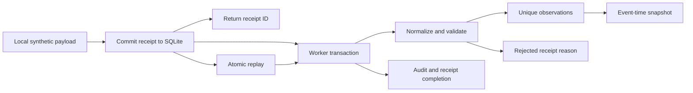

# Rail Webhook Inbox

[](https://github.com/muhammad-musa-ml/rail-webhook-inbox/actions/workflows/ci.yml)

A small, offline customer-integration prototype: durably receive a rail geofence notification, recover processing after a worker crash, and explain which observation a customer application should display.

## How this relates to BNSF's public webhook guide

BNSF's [public webhook guide](https://www.bnsf.com/ship-with-bnsf/support-services/customer-api/push-notifications/) describes customer event delivery, including geofence notifications, and recommends persisting requests before processing. This repository implements that integration pattern locally and adds replay, duplicate suppression and conservative handling of conflicting timestamps. It uses the published payload structure with invented values. It does not connect to BNSF, access internal code or establish that BNSF has a defect.

The improvement is to an independently implemented customer consumer. It is a new project, separate from [Railcar Orders](https://github.com/muhammad-musa-ml/railcar-orders): webhook ingestion and reconstruction rather than car ordering or allocation.

## Try it in a minute

Python 3.11–3.13, with SQLite support. There are no runtime package dependencies, credentials or services to start. From the cloned repository:

```sh
python -m rail_inbox demo

python -m rail_inbox --db inbox.db receive fixtures/geofence.json --source-offset=+00:00
python -m rail_inbox --db inbox.db stats
python -m rail_inbox --db inbox.db work
python -m rail_inbox --db inbox.db snapshot
python -m rail_inbox --db inbox.db audit
python -m rail_inbox --db inbox.db replay
```

`receive` prints a committed receipt ID only after the database commit succeeds. It stores valid UTF-8 text before parsing the event. `work` processes pending receipts, retaining rejected input and a reason for inspection. The CLI does not expose an HTTP endpoint.

`+00:00` is a synthetic fixture assumption. A real adapter must supply the known offset for each event; missing offsets are rejected during processing. Do not infer a provider timezone or daylight-saving rule from this example.

## Reproducible before / after

The [seven-delivery fixture](fixtures/scenario.json) includes a worker outage, a late event, a redelivery with reordered JSON keys, two differing observations in one minute and a mismatched equipment count. The [committed result](results/demo.json) is checked against a fresh run in CI.

| In this synthetic fixture | In-memory arrival-order baseline | Durable inbox |
|---|---:|---:|
| Deliveries lost during worker outage | 1 | 0 |
| Asset projections differing from the explicit fixture oracle | 3 / 3 | 0 / 3 |
| Conflicting latest observation shown as unambiguous | 1 | 0 |
| Duplicate receipt effects suppressed | 0 | 1 |
| Rejected malformed receipt retained with reason | 0 | 1 |
| Rebuild matches pre-replay snapshot and audit | unavailable | yes |

The baseline is deliberately simple teaching code, **not BNSF's implementation**. The three baseline errors are a stale observation, a missing asset and an arbitrary choice between conflicting observations. These are fixture correctness results, not production measurements or performance benchmarks. The durable result preserves one ambiguous asset for review; it does not resolve that uncertainty.

## How it works



- **Durability:** SQLite rollback journal and `synchronous=EXTRA`, using the local filesystem. A receipt stays pending if the worker process exits before its transaction commits.
- **Atomic processing:** claim, candidate insert, audit entry and completion use one `BEGIN IMMEDIATE` transaction. Two workers on the same database serialize at that boundary.
- **Content identity:** SHA-256 of normalized observations ignores object-key and equipment-list order. Every delivery remains in `receipts`; duplicate content does not insert another observation.
- **Event time:** the display uses the greatest observed UTC timestamp per `(customer_id, equipment_id)`, so a late older event cannot replace a newer one.
- **Uncertainty:** different candidates at the greatest timestamp produce `status: ambiguous` with all candidates. Their ordering in the JSON response is deterministic, but that ordering does not select a winner.
- **Audit and replay:** raw receipt text, supplied offset and reception time are retained. Replay rebuilds derived tables atomically without editing those evidence fields. A failed replay rolls back to the previous projection.

The snapshot is the latest **reported geofence observation**, not a live asset position or proof that all upstream events arrived. `current` means unambiguous among the observations received here.

## Verify locally

```sh
python -m pip install -r requirements-dev.txt
python -m ruff check .
python -m ruff format --check .
python -m mypy
python -m unittest discover -v
python scripts/record_demo.py --check
```

24 tests include a real subprocess exit between projection writes and completion, transaction rollback, two competing workers, database-write failure, storage-mode verification, poison input, timestamp and count validation, overlapping equipment lists, customer separation, atomic replay and all **120 arrival permutations** of a five-delivery fixture. CI runs these checks on Linux with Python 3.11/3.12/3.13 and Windows with Python 3.13. Its workflow has read-only repository permissions and uses pinned action commits.

## Scope and tradeoffs

This is an independent, synthetic-data engineering prototype with no affiliation or endorsement. It is not deployed, registered with BNSF or suitable for dispatch, train, vehicle, drone or other safety decisions.

The content hash is an integration assumption, not an authoritative provider event ID. Identical repeat crossings in the same minute cannot be distinguished from redelivery. Changed header fields conservatively create a distinct candidate; production semantics would need agreement with the provider. Source ordering, delivery guarantees and timezones are not inferred.

The inbox is single-host, serializes writers and scans retained observations for snapshots. Replay takes a write lock and loads receipts into memory. There is no authentication, TLS listener, access-control layer, retention policy, network retry service, distributed queue, external side-effect delivery or high-availability configuration. Customer IDs separate projections, not authorization. The audit is inspectable, not tamper-evident. Local disk failure, exhausted capacity and power-loss behavior beyond SQLite/filesystem guarantees are outside the demonstration.

The adapter deliberately supports only the geofence example structure. Limits of 64 KiB per receipt, 300 equipment IDs, 12 JSON nesting levels and bounded identifier lengths are this prototype's choices, not BNSF API limits.

See [design decisions and interview walkthrough](docs/design.md) for the failure boundaries and the next production steps. MIT licensed; all fixtures are synthetic.
